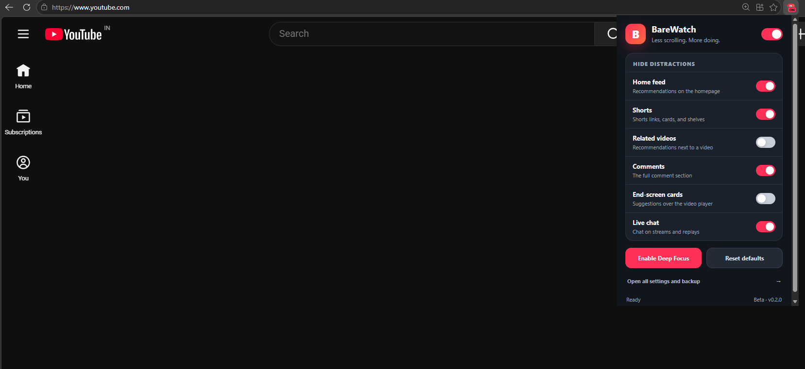
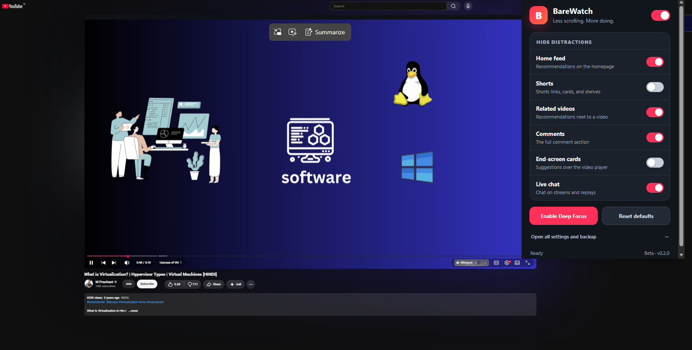

<p align="center">
  
</p>

<h1 align="center">BareWatch</h1>

<p align="center">
  <strong>Hide the sections of YouTube you don't want to see.</strong><br>
  Less scrolling. More doing.
</p>

<p align="center">
  
  
  
  
  
</p>

---

## What is BareWatch?

BareWatch is a lightweight Chrome/Edge extension that gives you granular control over YouTube's distracting interface elements. Toggle off homepage recommendations, Shorts, related videos, comments, end-screen cards, live chat, and more, while keeping search and video playback fully functional.

## Demo

<p align="center">
  <br>
  <em>BareWatch popup on the YouTube homepage — home feed and Shorts hidden</em>
</p>

<p align="center">
  <br>
  <em>BareWatch popup on a video page — related videos, comments, and live chat hidden</em>
</p>

## Features

### Distraction Controls

| Control                  | Description                                             | Default |
| ------------------------ | ------------------------------------------------------- | ------- |
| **Home feed**            | Hides homepage video recommendations                    | ✅ On   |
| **Shorts**               | Hides Shorts links, cards, and shelves across YouTube   | ✅ On   |
| **Related videos**       | Hides the recommendation sidebar/section on watch pages | ✅ On   |
| **Comments**             | Hides the entire comment section                        | ❌ Off  |
| **End-screen cards**     | Hides overlay suggestions on the video player           | ✅ On   |
| **Live chat**            | Hides live and replay chat panels                       | ❌ Off  |
| **Explore / Trending**   | Hides navigation links to discovery feeds               | ❌ Off  |
| **Notification bell**    | Hides the YouTube notification button                   | ❌ Off  |
| **Homepage topic chips** | Hides category filter chips above the home feed         | ❌ Off  |

### Quick Actions

- **Deep Focus** — Enables every hiding rule at once for maximum distraction-free viewing
- **Recommended Defaults** — Restores the balanced starter configuration
- **Master Switch** — Pause all rules while preserving your individual choices
- **Keyboard Shortcut** — Toggle everything with `Alt+Shift+F` (Windows/Linux) or `⌘+Shift+F` (macOS), customizable through browser settings

### Backup & Diagnostics

- **Export** your settings as a timestamped JSON file
- **Import** settings from a previous backup with full validation
- **Copy Safe Diagnostics** for bug reports (never includes watch history or account data)
- **Reset** all settings to defaults

### Privacy First

- All preferences stored locally in `chrome.storage.local`
- Only permission used: `storage`
- Content scripts scoped exclusively to `https://www.youtube.com/*`
- **Zero**: analytics, ads, accounts, remote scripts, external servers
- **Never** collects or transmits: watch history, searches, video URLs, or account details

Read the full [Privacy Policy](PRIVACY.md).

## Installation

### Load Unpacked (Developer Mode)

1. **Clone** or **download** this repository:
   ```bash
   git clone https://github.com/YourUsername/BareWatch.git
   ```
2. Open **`chrome://extensions`** (Chrome) or **`edge://extensions`** (Edge)
3. Enable **Developer mode**
4. Click **Load unpacked** and select the folder containing `manifest.json`
5. Open or refresh any YouTube tabs

> [TIP]
> Pin the BareWatch icon in your browser toolbar for quick access to the popup controls.

> [WARNING]
> Moving the unpacked extension folder can change its extension ID and reset your saved preferences.

## Usage

### Popup (Quick Controls)

Click the BareWatch toolbar icon to access everyday toggle switches for the six most common distractions, along with Deep Focus and Reset buttons.

### Full Settings Page

Click **"Open all settings and backup"** in the popup, or navigate to the extension's options page for:

- All nine hiding controls organized by category (Watching / Browsing)
- Preset buttons (Deep Focus / Recommended)
- Keyboard shortcut display and configuration link
- Toolbar badge toggle
- Settings backup, import, and diagnostics

### Keyboard Shortcut

| Platform        | Default Shortcut  |
| --------------- | ----------------- |
| Windows / Linux | `Alt + Shift + F` |
| macOS           | `⌘ + Shift + F`   |

Customize through your browser's extension shortcut settings if there's a conflict.

## Architecture

```
BareWatch uses class toggling on the document root — YouTube elements are hidden
via reversible rules, never deleted. A MutationObserver watches for DOM changes
and batches link-marking work through requestAnimationFrame for performance.
```

### Settings Flow

```
  Popup / Options Page / Keyboard Shortcut
                    ↓
        shared/settings.js (validates)
                    ↓
          chrome.storage.local (saves)
                    ↓
        storage.onChanged (broadcasts)
             ↙                 ↘
  YouTube content scripts    Popup / Options / Badge
```

### How Hiding Works

1. The content script adds state classes (e.g., `barewatch-hide-shorts`) to `<html>`
2. The stylesheet uses these classes as selectors to `display: none` matching YouTube components
3. Link-based rules (Shorts, Explore) mark containers via `data-*` attributes by matching URL patterns , not language-specific labels
4. YouTube card reuse is handled by clearing old markers before rescanning

## 📁 Project Structure

```
BareWatch/
├── manifest.json
├── package.json
├── background/
│   └── service-worker.js
├── content/
│   ├── content.js
│   └── youtube.css
├── shared/
│   └── settings.js
├── popup/
│   ├── popup.html
│   ├── popup.js
│   └── popup.css
├── options/
│   ├── options.html
│   ├── options.js
│   └── options.css
├── welcome/
│   ├── welcome.html
│   ├── welcome.js
│   └── welcome.css
├── icons/
├── tests/
├── tools/
├── docs/
├── store-assets/
└── .github/workflows/
```

## Development

### Prerequisites

- **Node.js 22+** (for running tests only, not required for the extension itself)
- No npm dependencies to install

### Running Tests

```bash
npm test
```

This runs:

- Settings validation and migration tests
- Import parsing and edge-case tests
- Popup and options page synchronization tests
- Content script update and toolbar behavior tests
- Repository integrity checks (manifest paths, icon dimensions, etc.)

Tests use browser API stubs. Run the [manual browser test matrix](tests/manual-test-matrix.md) against real YouTube before any release.

> [!NOTE]
> If PowerShell blocks `npm.ps1`, use `npm.cmd test` instead.

### Building a Release

```powershell
powershell -ExecutionPolicy Bypass -File tools/build-release.ps1
```

This creates `release/BareWatch-v0.2.0.zip` with `manifest.json` at the ZIP root. The `release/` directory is git-ignored. Existing ZIPs are not overwritten — move the old one or pass a different `-OutputDirectory`.

### CI Pipeline

GitHub Actions runs on every push, pull request, and manual dispatch:

- All automated tests via `npm test`
- Release packaging verification via `build-release.ps1`

## Compatibility

| Browser              | Status                                     |
| -------------------- | ------------------------------------------ |
| Google Chrome 105+   | ✅ Supported                               |
| Microsoft Edge 105+  | ✅ Supported                               |
| Other Chromium-based | 🟡 Should work (untested)                  |
| Firefox              | ❌ Not supported (Manifest V3 differences) |

## 📄 License

[MIT](LICENSE) © 2026
